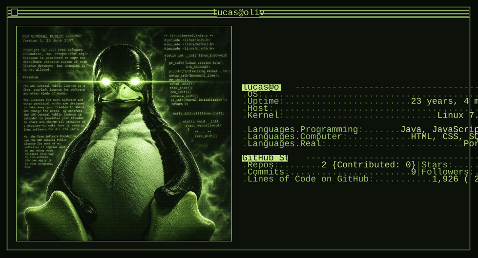

Sou estudante de Ciência da Computação e desenvolvedor de software. Meu foco de estudo é arquitetura de computadores (x86-64), redes, sistemas operacionais (Unix) e matemática.

Procuro entender como os componentes funcionam e se conectam, partindo do substrato e vendo o que cada camada de abstração esconde.

## Stack

